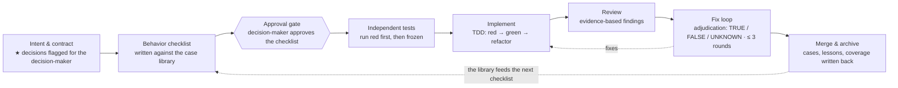

English | [简体中文](README.zh-CN.md)

# agent-workflow-kit

> A spec-first, test-first development workflow for solo builders and small teams who ship software with multiple AI coding agents.


Most AI coding workflows fail in predictable ways: the agent writes tests that mirror its own implementation (so the tests prove nothing), reviewers raise findings with no reproducible evidence (so fixes thrash), and project conventions live in chat logs (so they are forgotten within a week). This kit is a complete, portable workflow distilled from a production project that runs on it daily. It is **stack-agnostic**: the mechanisms work the same for iOS, Android, Web, and servers in Go, Java, Node.js, Python, or anything else — only the tool mapping changes.

## The workflow at a glance

- **Three roles, one merge key.** A human decision-maker approves intent, contracts, and acceptance checklists, and is the only one who merges. A *Writer* agent drafts and implements. A *Reviewer* agent (ideally a different model) writes tests independently and reviews with evidence.
- **An eight-step pipeline per feature.** Intent & contract → behavior checklist & plan → approval gate → independent tests, frozen → implementation with self-verification → evidence-based review → adjudicated fix loop → merge & archive.
- **A behavior-level test-case library as the single source of truth.** Test cases are written as platform-neutral business behavior (Given/When/Then, no implementation words), one file per feature, with a coverage matrix across every client platform. New platforms consume the same library in a compressed "Delta mode".
- **Contracts before code.** Server/API contracts are drafted against an eight-part checklist; product decisions are flagged ★ and only the human decides them.
- **Evidence-based review.** Every finding needs a file:line, a reproduction (or a spec reference), expected vs. actual, and a hint for how to refute it. Unverifiable findings don't drive rework.
- **Machines enforce, documents explain.** Anything a machine can check becomes a lint rule or a CI gate. Critical rules are `error`, never `warn` — a warning that keeps CI green is not a rule.
- **Everything is archived.** Hidden acceptance scenarios, review lessons, and coverage status are written back into the library after every merge, so each mistake is paid for exactly once.

Full design document: [docs/blueprint.md](docs/blueprint.md) — bilingual: [中文](docs/blueprint.md) / [English](docs/blueprint.en.md).

## The workflow at a glance



Three roles throughout: the **decision-maker** (a human) approves and merges; the **Writer** drafts and implements; the **Reviewer** writes tests independently and reviews — no step is self-certified.

## What's in the kit

```text
docs/blueprint*.md  The full design (Chinese + English editions): 12 core
                    mechanisms, 5 adoption phases, per-stack adaptation
                    tables, project "slots", anti-patterns
templates/          Blank templates for all 11 workflow documents — AGENTS.md,
                    REVIEW.md, review protocol, TDD spec, contract checklist,
                    coding standards, project-management set, platform playbook,
                    review ledger, and the test-case library (TEMPLATE + INDEX)
                    — plus lint-starters/ with per-stack lint configs
scripts/            The one-command installer (install.py: scaffolds the whole
                    kit into your repository, never overwrites existing files)
                    and the TDD compliance gate (zero-dependency Python):
                    production changes must ship with paired tests containing
                    negative assertions. Both ship with their own tests
examples/           Three worked examples: "join by invite code" (the full
                    pipeline, runnable code, real red/green evidence), a
                    Delta-mode second platform, and a hotfix lane
```

Start with the [worked example](examples/invite-code/) if you want to see the workflow's artifacts before reading the theory.

## Getting started

**Hands-on path**: follow the [Quickstart](docs/quickstart.md) ([简体中文](docs/quickstart.zh-CN.md)) — a 30-minute guided adoption: copy the templates, fill the eight slots, wire the gate, run your first feature. The conceptual path:

1. Read the [blueprint](docs/blueprint.md) — it defines the 12 core mechanisms, the five adoption phases, and the per-stack adaptation tables.
2. Scaffold your repository — run [scripts/install.py](scripts/) from your repo root (or copy the [templates](templates/) by hand; the templates README maps each file to its destination) — and fill in the eight project "slots" (data-isolation dimension, project invariants, failure definitions, high-risk paths, ★ decisions, mandatory failure branches, design source, risk grading).
3. Wire the [gate script](scripts/) into CI, then run one small real feature through the full pipeline before scaling up.

## Status

**v0.3.3** — Current release. The roadmap is complete (see the v0.3.0 notes): bilingual blueprint and documentation, Delta-mode and hotfix worked examples, per-stack lint starter packs, a Mermaid workflow diagram in both READMEs — and the installer now bootstraps itself: one curl line from your repository root installs everything — always the latest release, no clone needed. (Earlier: v0.2.0 full Chinese documentation; v0.1.0 first public release.)

This repository follows its own workflow where it applies: its CI runs the kit's test suites on every push and PR, and PRs use the kit's conventions (`Refs #`, risk self-assessment, evidence).

## Contributing

Contributions are welcome — see [CONTRIBUTING.md](CONTRIBUTING.md). For non-trivial changes, open an issue describing intent and non-goals first; that is the workflow the kit teaches.

## License

MIT © 2026 Shinji
